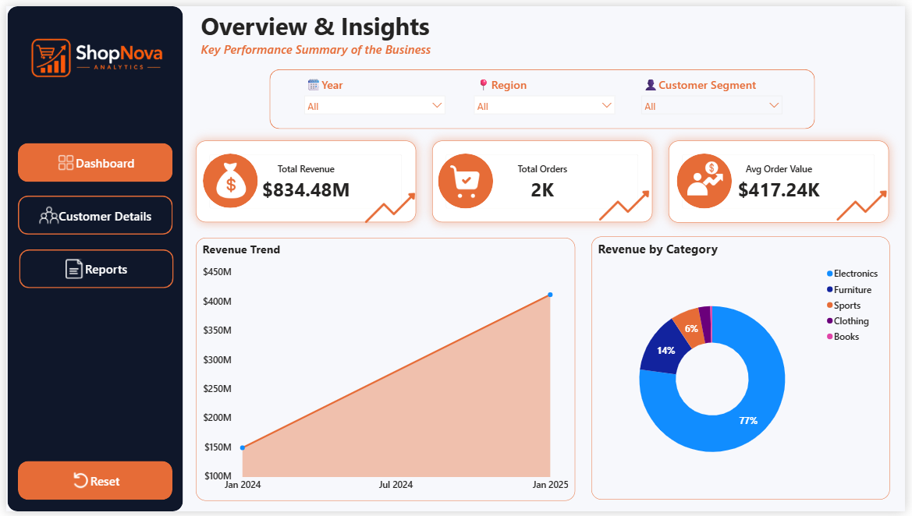

# ShopNova Retail Analytics Dashboard

## Project Overview

ShopNova Retail Analytics is a retail data analysis project developed using Power BI to explore sales performance, revenue trends, profitability, and customer purchasing patterns.

The project transforms e-commerce data into an interactive dashboard that helps stakeholders monitor key performance indicators, identify trends, and make informed business decisions.

## Business Objectives

- Monitor overall revenue, order volume, and profit.
- Analyze monthly revenue trends.
- Understand sales distribution across product categories.
- Explore performance across regions, years, and customer segments.
- Provide insights that can support business planning and decision-making.

## Tools and Technologies

- **Microsoft Power BI** — dashboard development and data visualization.
- **Power Query** — data preparation and transformation.
- **DAX** — calculations and key performance indicators.
- **CSV dataset** — source data for the analysis.

## Dashboard Features

 

The dashboard includes:

- **Key Performance Indicators (KPIs):** Total Revenue, Total Orders, and Total Profit.
- **Monthly Revenue Trend:** Tracks revenue performance over time.
- **Sales by Category:** Shows how sales are distributed across product categories.
- **Interactive Filters:** Enables exploration by year, region, and customer segment.

## Key Business Insights

Analysis of the ShopNova e-commerce dataset revealed the following findings:

1. **Revenue Performance:** The business recorded **$834.48 million** in revenue from 1,712 completed orders out of 2,000 total orders.
2. **Category Performance:** Electronics was the leading category, generating **$643.34 million** in completed-order revenue, making it the largest contributor to sales.
3. **Geographical Performance:** Lagos recorded the highest completed-order revenue at **$128.76 million**, followed by Warri and Owerri.
4. **Product Performance:** The MacBook Air M2 was the highest-revenue product, generating **$115.9 million** in sales.
5. **Order Fulfilment:** 85.6% of all recorded orders were completed, while 85 orders were cancelled.
6. **Profitability:** Estimated gross profit from completed orders was **$201.37 million**, calculated using selling prices and product costs.
   
### Order Status Clarification
The analysis covers 2,000 total orders received across the reporting period. Of these, 1,712 were completed and 85 were cancelled. The remaining 203 orders fall under other order statuses and are included in the overall order count. Therefore, completed and cancelled orders do not represent the entire order distribution.

## Business Recommendations

- **Strengthen Electronics Sales:** Maintain stock availability for high-performing electronics and explore opportunities to increase sales in other categories.
- **Improve Regional Marketing:** Use Lagos as a benchmark for successful sales strategies while developing targeted campaigns for other cities.
- **Promote Top-performing Products:** Prioritise popular products such as the MacBook Air M2 through targeted promotions and inventory planning.
- **Reduce Order Cancellations:** Investigate the reasons behind cancelled orders and improve the ordering and fulfilment process.
- **Monitor Profitability:** Track gross profit alongside revenue to ensure that sales growth translates into stronger business performance.

## Dashboard Preview

The dashboard provides a consolidated view of retail performance through interactive visualizations and KPI cards.

## Key Business Questions

This analysis is designed to answer questions such as:

1. How much revenue and profit does the business generate?
2. How does revenue change over time?
3. Which product categories contribute to sales?
4. How does performance vary by region?
5. How do customer segments differ in their contribution to business performance?

## Business Value

The dashboard gives decision-makers a practical way to monitor performance, explore sales patterns, and identify areas that may require further investigation.

Potential applications include revenue monitoring, category performance analysis, regional comparisons, and customer segment analysis.

## Author

**Lilian Ochagwuba**

Aspiring Data Analyst | Power BI | Data Visualization | Business Insights

This project is part of my data analytics portfolio, showcasing my ability to transform data into interactive visualizations for business decision-making.
